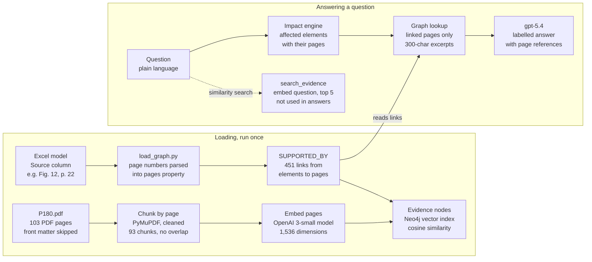

# Evidence Retrieval in the AI Architecture Advisor

2 November 2026

## Summary

Yes, the Advisor uses retrieval-augmented generation, but the evidence in its answers comes from the knowledge graph, not from similarity search. Each answer's P180 passages are found by following `SUPPORTED_BY` links from the affected elements to the pages their Excel Source cites. This is a graph lookup: deterministic and exact.

A classic vector search layer also exists and is tested. Each P180 page is one chunk, embedded with OpenAI `text-embedding-3-small` (1,536 dimensions) and stored in a Neo4j vector index using cosine similarity. It finds pages by meaning ("baggage tracking" returns the Ground Operations pages first), but the current answer flow does not call it.

## Pipeline overview



Pages are chunked and embedded once, and the Excel's Source citations become links to those pages. When a question comes in, the answer's evidence comes from the graph links. The dashed vector search path exists but does not feed answers.

## Chunking

One chunk is one printed P180 page, giving 93 chunks (printed pages 1 to 93) with no overlap. The text is extracted with PyMuPDF in `scripts/load_evidence.py`.

| Property | Value |
| --- | --- |
| Chunk unit | One PDF page |
| Number of chunks | 93 |
| Pages skipped | 10 front-matter pages (cover, contents, list of figures, preface) |
| Average size | About 2,000 characters (roughly 500 tokens) |
| Size range | About 100 to 5,700 characters |
| Overlap | None |
| Cleaning | Running headers and the page number line removed, empty lines dropped |
| Stored with each chunk | Printed page number, PDF page number, section heading, text, text hash, embedding |

Why pages and not smaller chunks: the Excel cites printed pages ("P180 Fig. 37, p. 59"), so a page is the unit every citation points to. Most cited pages are single figures, and splitting a figure would separate an application from the capabilities drawn inside it.

The section heading comes from the PDF bookmarks: it is the section in force at the top of the page. Printed page numbers are 10 lower than PDF page numbers (printed page 59 is PDF page 69), and the printed number is the one stored.

## Embeddings

Every page is embedded once with OpenAI `text-embedding-3-small`, which returns a 1,536-dimension vector. The same model embeds the user's text at search time, so both sit in the same vector space.

| Property | Value |
| --- | --- |
| Model | OpenAI `text-embedding-3-small` |
| Dimensions | 1,536 |
| Input | The cleaned text of one page |
| Batching | 50 pages per API call |
| Storage | Node property `embedding` on each `Evidence` node, written with `db.create.setNodeVectorProperty` |
| Re-embedding | Skipped when a page's SHA-256 hash of model name plus text is unchanged |
| Cost | Embedding all 93 pages is roughly 50,000 tokens, well under one US cent |

The hash includes the model name, so switching to another embedding model re-embeds every page automatically. A second run of the loader embedded 0 pages.

## Vector index and similarity search

Similarity search uses cosine similarity over a native Neo4j vector index, so no separate vector database is needed. `search_evidence(question, k)` in `backend/evidence.py` embeds the question and returns the `k` most similar pages (default 5).

| Property | Value |
| --- | --- |
| Vector store | Neo4j AuraDB Free (Neo4j 5.27), the same database as the graph |
| Index | `evidence_embedding` on `Evidence.embedding` |
| Similarity function | Cosine |
| Search type | Approximate nearest neighbour (Neo4j vector indexes use HNSW) |
| Results returned | Top k pages, default k = 5, with score, page, section and a 300-character excerpt |
| Query clause | Cypher `SEARCH` (replaces the deprecated `db.index.vector.queryNodes`) |

The query, with the question's embedding passed as a parameter:

```cypher
MATCH (node:Evidence)
  SEARCH node IN (VECTOR INDEX evidence_embedding FOR $vector LIMIT $k) SCORE AS score
RETURN node.page, node.section, node.text, score
ORDER BY score DESC
```

There is no keyword (hybrid) search and no re-ranking step.

## Graph-based retrieval used in answers

Answers get their evidence by following `SUPPORTED_BY` links, so every passage shown is a page the Excel model itself cites. The vector search is not used for this, because a page that is merely similar in meaning would not prove the fact.

1. When the Excel is loaded, the page numbers in each Source value (for example "P180 Fig. 12, p. 22; P180 Fig. 27, p. 43") are parsed into a `pages` property on every element and relationship.
2. One Cypher query links each element to the `Evidence` node of every page it cites: 451 `SUPPORTED_BY` links for the 342 elements. It reruns after every reload of the Excel.
3. For an answer, `evidence_for_elements(names)` collects the pages linked to the replaced application and its direct elements: its capabilities, subdomain, domain, platform and components.
4. Each finding also carries the pages of the relationships behind it. Those page numbers are what the answer shows next to each statement.

For Booking System this returns pages 8 and 22. Page 22 is the Sales application architecture figure, which shows the application and its seven capabilities.

## What the LLM receives

The answer model (`gpt-5.4`) never sees whole pages or the database. It gets one JSON message with three parts:

- **Findings** from the impact engine, each with an id (F1, F2 and so on), its label (Documented fact or Inference) and its P180 pages
- **Gaps**: what P180 does not document, each with an id (G1, G2 and so on)
- **Evidence excerpts**: page number, section heading and an excerpt of at most 300 characters per linked page

Each excerpt is cut around the first occurrence of an element name on the page, starting about a third of the window before it, with its edges snapped to word boundaries and "…" marking cut text. The longest names are tried first, so "Product Maintenance Application" wins over "Maintenance". The vector search cuts its excerpts the same way, around the question's words.

The model must cite finding ids in every statement. The code then attaches page numbers from the cited findings, so the model cannot invent a page reference.

## Measured results

The vector search passes its acceptance test, and every element with a Source is linked to its evidence. Scores are cosine similarities from one run.

| Check | Result |
| --- | --- |
| Elements with a Source but no `SUPPORTED_BY` link | 0 of 342 |
| `SUPPORTED_BY` links | 451 |
| Relationships with page numbers | 473 of 473 |
| "baggage tracking", top result | p. 36, Ground Operations technology architecture (score 0.700) |
| "baggage tracking", top 5 pages | 36, 64, 30, 61, 33: three Ground Operations, two Cargo |
| "Who handles crew scheduling?", top 5 pages | 76, 75, 77, 50, 78: Flight Operations processes and business architecture (scores 0.75 to 0.79) |
| Documented facts with a page reference (evaluation, 20 questions) | 32 of 32 |

The two Cargo pages in the baggage results (64 and 61) are near misses on meaning: they cover cargo tracking and forwarding. Scores sit close together (0.68 to 0.70), so the ranking separates relevant from related pages only weakly.

## Limitations and improvements

The biggest weakness is the text itself: most cited pages are diagrams, and their extracted text is a run of box labels rather than readable sentences.

| Limitation | Effect | Possible improvement |
| --- | --- | --- |
| Figure pages extract as label lists ("…Reservation Ticketing Booking System Search Flight…") | Excerpts prove an element is on the page but read poorly | Show a cropped image of the figure, rendered with PyMuPDF, with the element highlighted |
| One chunk per page, no overlap | A page that mixes two sections gives one blended vector | Split pages at section headings; keep figures whole |
| Vector search not used in answers | Text passages that explain a capability are never shown | Add the top 2 to 3 similarity results as a separate "related reading" list, clearly marked as not cited by the model |
| Pure vector search, no keyword match, no re-ranking | Exact names can rank below related pages (Cargo pages in the baggage results) | Hybrid search: add a Neo4j full-text index and merge both rankings |
| Index fixed at 1,536 dimensions | Changing to a model with other dimensions needs a new index | Recreate the index when the model changes |
| Evidence limited to pages the Excel cites | Inferences (shared data, shared platforms) carry pages but no excerpt of their own | Fetch excerpts for the pages behind inference findings too |
